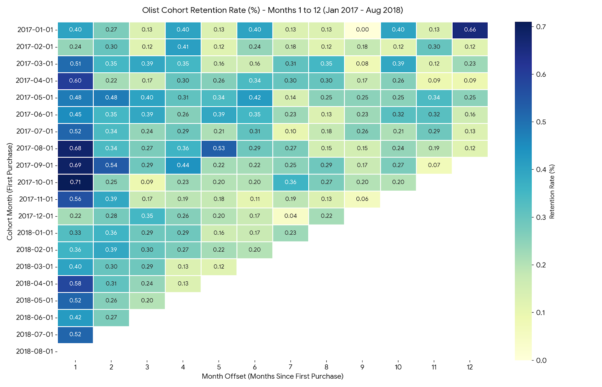

# 📦 Olist E-Commerce: Customer Cohort & Retention Analysis

> Do customers who buy once on a Brazilian marketplace ever come back? A SQL-driven cohort analysis of ~100k orders, visualized as a retention heatmap.


---

## 📑 Table of Contents

1. [Introduction](#-introduction)
   - [Data Source](#data-source)
   - [Project Goal](#project-goal)
2. [Methodology](#-methodology)
   - [Step 1 – Building the database](#step-1--building-the-database)
   - [Step 2 – Data quality checks (EDA)](#step-2--data-quality-checks-eda)
   - [Step 3 – Cleaning the orders](#step-3--cleaning-the-orders)
   - [Step 4 – Assigning customers to cohorts](#step-4--assigning-customers-to-cohorts)
   - [Step 5 – Building the retention matrix](#step-5--building-the-retention-matrix)
   - [Step 6 – Visualization](#step-6--visualization)
3. [The Cohort Heatmap](#-the-cohort-heatmap)
4. [Business Conclusions](#-business-conclusions)
5. [Recommendations](#-recommendations)
6. [Repository Structure](#-repository-structure)

---

# 🧭 Introduction

## Data Source

The data comes from the public **[Brazilian E-Commerce Public Dataset by Olist](https://www.kaggle.com/datasets/olistbr/brazilian-ecommerce?select=product_category_name_translation.csv)** on Kaggle.

Olist is a Brazilian platform that connects small businesses to the biggest online marketplaces in the country. The dataset contains information on roughly **100,000 real (anonymized) orders placed between 2016 and 2018**, spread across **9 related tables**:

| Table | What it contains |
|---|---|
| `orders` | One row per order: status and key timestamps (purchase, approval, delivery) |
| `customers` | Customer identifiers and location |
| `order_items` | The products inside each order, with price and freight |
| `order_payments` | How each order was paid (an order can have several payments) |
| `order_reviews` | Customer review scores and comments |
| `products` | Product attributes (category, size, weight, etc.) |
| `sellers` | Seller identifiers and location |
| `geolocation` | Brazilian zip codes mapped to coordinates |
| `product_category_name_translation` | Category names translated from Portuguese to English |

> 💡 **Important detail about the data:** in Olist, `customer_id` is generated *per order*, while `customer_unique_id` identifies the *actual person*. All customer-level analysis in this project therefore uses `customer_unique_id`.

## Project Goal

The goal of this project is to use **SQL** to prepare and analyze the data, and then to produce a **visual cohort analysis** that turns the numbers into business insight.

- **SQL (MySQL):** build the database, validate the data, clean it, and calculate the cohort retention table.
- **AI-assisted visualization:** the final heatmap was generated with **Google Gemini (model name: ARGON)**, which used **Python** to turn the SQL output into a retention heatmap.
- **Business insight:** read the heatmap and draw practical conclusions about customer loyalty and how the business can improve.

---

# 🛠 Methodology

The whole analysis is done in three SQL scripts, run in order.

## Step 1 – Building the database

📄 `script for buildings tables.sql`

- Creates the `olist_ecommerce` database and all 9 tables.
- Defines **primary keys** (e.g. a composite key `(order_id, order_item_id)` for order items, because the same order appears on several rows) and **foreign keys** that reflect the relationships in the schema.
- Loads each CSV file into its table with `LOAD DATA INFILE`, handling empty values (converted to `NULL`) and special characters in the reviews file.
- The `geolocation` table has no primary key, because a single zip code appears many times with different GPS points. It gets a regular index instead, to keep joins fast.

## Step 2 – Data quality checks (EDA)

📄 `EDA.sql`

Before analyzing anything, the data is validated:

| Check | Result |
|---|---|
| Row counts match the source files | ✅ e.g. 99,441 orders, 112,650 order items, 103,886 payments |
| Purchase date range | ✅ Falls within 2016–2018 as expected |
| Order status distribution | ✅ 96,478 of 99,441 orders are `delivered` |
| Missing dates | ✅ NULLs only appear where expected (e.g. orders not yet delivered) |
| Repeat customers | 📌 Only **2,997** customers bought more than once |

That last number already hints at the main story of this project: **very few customers come back**.

## Step 3 – Cleaning the orders

📄 `EDA.sql` / `Analysis.sql`

A reusable query block called **`clean_orders`** (a CTE) creates a clean base table with **one row per valid order**:

1. Each order is linked to its customer, so we know *who the real person is* (`customer_unique_id`).
2. **Canceled and unavailable orders are removed**, since they are not real sales. This leaves **98,207 of 99,441 orders**.
3. Payments are **summed per order *before* joining**. An order can be paid in several parts (for example credit card + voucher), and joining without summing first would duplicate the order and inflate the numbers.

## Step 4 – Assigning customers to cohorts

📄 `Analysis.sql` (section 7)

A **cohort** is a group of customers who made their **first purchase in the same month**.

For each customer, the query finds their earliest order and rounds it to the first day of that month. This is the customer's **cohort month** ("Month 0"). Customers are then counted per cohort to get the **cohort size**.

## Step 5 – Building the retention matrix

📄 `Analysis.sql` (section 8)

For every cohort, the query counts how many of its customers made **another purchase** 1, 2, 3 … months after their first one:

- **Month offset** = the number of months between the customer's first purchase and a later purchase.
- **Retention %** = customers who purchased again in that month ÷ original cohort size × 100.

The result is a table where each row is a cohort, each column is "months since first purchase", and each cell is the retention rate.

## Step 6 – Visualization

The retention table was exported and passed to **Gemini (ARGON)**, which used **Python** to generate the heatmap below. Darker cells mean higher retention.

---

# 🔥 The Cohort Heatmap

### The idea behind the table

Imagine every customer starts a "clock" the month they first buy. A cohort table lines customers up on **their own** clock instead of the calendar, so that customers who joined in January 2017 can be fairly compared with customers who joined in October 2017.

**How to read it:**

- **Each row** = a group of customers who first bought in the same month.
- **Each column** = how many months later we are looking (1 = the month after their first purchase, 2 = two months after, and so on).
- **Each cell** = the **percentage** of that group who bought again in that month.
- **The empty triangle** in the bottom right is normal: those months haven't happened yet in the data.

> ⚠️ **Note on the numbers:** the scale is in **percent**, not fractions. A cell showing `0.40` means **0.40%** of the cohort (less than half of one percent), not 40%.



---

# 💡 Business Conclusions

### 1. Almost nobody comes back
The most important finding is also the simplest: **in every month of every cohort, fewer than 1% of customers make another purchase** (the highest value on the whole map is about 0.7%). Out of tens of thousands of customers, only about 3% ever bought a second time. For this business, a customer is almost always a **one-time buyer**.

### 2. Growth comes from finding new customers, not from keeping old ones
Because returning customers are so rare, the business's growth depends almost entirely on constantly attracting *new* shoppers. This is an expensive way to grow, because new customers usually cost more to win than existing ones cost to retain.

### 3. The best chance to bring someone back is soon after the first purchase
For many cohorts, the **darkest cells are in Month 1** (for example, customers who first bought in August, September and October 2017 show the strongest first-month return, around 0.7%). This suggests that if a customer is going to return, it is most likely to happen **shortly after their first order**, while the experience is still fresh.

### 4. Retention does not clearly improve or fade over time
Looking across the later months, the numbers move up and down without a clear pattern. This means that there is **no natural "loyalty effect"** building up, and that waiting will not bring customers back on its own. Any improvement would have to be actively created.

### 5. Some "peaks" are just noise
A few cells look impressive (for example, the highest value for the January 2017 cohort appears at Month 12). But early cohorts are small (about 750 customers in January 2017), so one or two extra customers can visibly move a cell. These spikes should **not** be treated as real trends.

### 6. Late-2017 cohorts looked healthier than early-2018 ones
Cohorts from the second half of 2017 (August to November) tend to show stronger Month 1 return rates than many of the 2018 cohorts. This is worth investigating: it may be connected to the holiday and promotional season, or to the types of customers acquired in that period.

> **Caveat:** the dataset covers only about two years, and the most recent cohorts have few months of history. These conclusions describe patterns in this data and are not guarantees of future behavior.

---

# 🚀 Recommendations

Because the key problem is **one-time buyers**, the suggestions below focus on giving customers a reason to return.

1. **Act in the first month after purchase.** Send a well-timed follow-up (email, notification or message) shortly after delivery, thanking the customer and suggesting related products. This is when customers are most likely to return.

2. **Offer a "second purchase" incentive.** A small discount or free shipping on the next order gives first-time buyers a concrete reason to try again. Test different offers and timings to see what works best.

3. **Recommend products that naturally lead to repeat purchases.** Suggest accessories, refills or complementary items related to what the customer just bought, and promote categories people buy regularly.

4. **Build a loyalty program.** Points, rewards or member-only prices can turn a one-off shopper into a regular. Even moving retention from under 1% to 2–3% would double or triple the number of returning customers.

5. **Improve the delivery and review experience.** A smooth delivery and a good first impression make people more willing to come back. Use review scores to find and fix the problems that cause unhappy first-time buyers to leave for good.

6. **Re-engage after "quiet" periods.** Since customers rarely return on their own, run win-back campaigns a few months after the first order rather than waiting.

7. **Measure and test.** Use this cohort heatmap as a **baseline**. After launching any of the ideas above, compare the new cohorts against it to see whether they actually improved retention.

8. **Balance acquisition and retention spending.** Since nearly all revenue comes from first-time buyers, shifting even a small part of the marketing budget toward bringing existing customers back may be more cost-effective than acquiring new ones.

---

# 📁 Repository Structure

```
├── README.md                          # Project overview (this file)
├── cohort_heatmap.png                 # Final cohort retention heatmap
├── script for buildings tables.sql    # Creates the database, tables, keys, and loads the CSV files
├── EDA.sql                            # Data quality checks and the clean_orders CTE
└── Analysis.sql                       # Cohort assignment and retention matrix queries
```

## ▶️ How to Reproduce

1. Download the dataset from [Kaggle](https://www.kaggle.com/datasets/olistbr/brazilian-ecommerce?select=product_category_name_translation.csv) and place the CSV files in your MySQL uploads folder.
2. Update the file paths in `script for buildings tables.sql` to match your machine, then run it.
3. Run `EDA.sql` to validate the data.
4. Run `Analysis.sql` to produce the cohort retention table.
5. Export the result of the final query and use it to create the heatmap in Python.

---

## 🛠 Tools Used

- **MySQL 8.0** – database, data cleaning, and cohort analysis (CTEs, joins, window of dates with `TIMESTAMPDIFF`)
- **Python** – heatmap generation, created with **Google Gemini (ARGON)**
- **Kaggle** – dataset source
